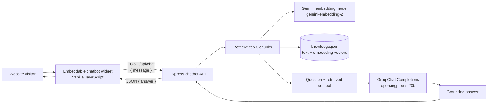
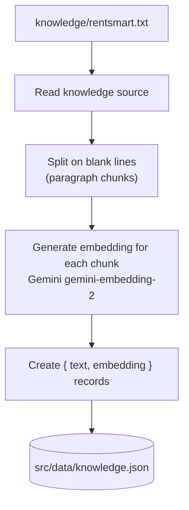

# RentSmart RAG Chatbot

A Retrieval-Augmented Generation (RAG) chatbot for the RentSmart platform. This repository contains two decoupled components: an Express backend that retrieves relevant RentSmart knowledge and generates answers, and a lightweight JavaScript widget that can be embedded on a website with one script tag.

The backend grounds responses in the supplied RentSmart knowledge base. It does not use a hosted vector database: chunk embeddings are stored in a local JSON file and searched in-process using cosine similarity.

## System architecture



## RAG pipeline

### Knowledge ingestion (offline / build-time step)



Run the ingestion script from the `chatbot-service` directory:

```bash
node index.js
```

The script reads `knowledge/rentsmart.txt`, splits the text at double newlines, embeds each non-empty chunk sequentially, and writes the resulting array to `src/data/knowledge.json`. Re-run ingestion whenever the knowledge source changes. The generated JSON is loaded from disk by the retrieval module on each question.
 
## Retrieval and answer generation

1. The incoming question is converted to an embedding using Google's `gemini-embedding-2` model.
2. The service reads the stored chunk/embedding pairs from `src/data/knowledge.json`.
3. It calculates cosine similarity between the query vector and every stored embedding.
4. Results are sorted by similarity (highest first); the default `topK` is **3**.
5. The selected chunk text is combined with the question and sent to Groq.
6. The configured prompt instructs the model to answer only from the supplied RentSmart context and to say when the context does not contain the answer.

The service currently performs an in-memory linear scan over the JSON records for each request. It does not use a vector database, persistent conversation memory, metadata filters, or a reranker.

## API

The backend runs on `PORT` or defaults to `5005`.

| Method | Endpoint | Purpose |
|---|---|---|
| GET | `/health` | Basic service health response |
| POST | `/api/chat` | Retrieve context and generate an answer |

### Chat request

```http
POST /api/chat
Content-Type: application/json
```

```json
{
  "message": "How can I unlock a property's contact details?"
}
```

Successful response:

```json
{
  "answer": "..."
}
```

A missing or whitespace-only message returns `400` with `{ "message": "Question is required" }`. Unexpected errors are logged by the backend and return `500` with a generic error message.

### Health check

```http
GET /health
```

Returns a simple status message indicating that the chatbot service is running.

## Embeddable widget

The `chatbot-widget` directory contains a framework-free widget:
- `chatbot.js` builds the floating launcher, chat window, message list, typing indicator, and input controls.
- `chatbot.css` styles the widget.
- `index.html` demonstrates the current hosted widget and backend endpoint configuration.

The widget:
- Creates its UI dynamically; no host-page markup is required.
- Uses an open Shadow DOM root to isolate widget markup and styles from the host page.
- Loads `chatbot.css` relative to the script URL by default.
- Sends the message to the configured API using `fetch`.
- Uses `textContent` / text nodes for message content rather than injecting response text as HTML.
- Disables the input while a request is in progress and displays a typing indicator.
- Shows a friendly in-chat error when the request fails.

### Embed on a website

Host `chatbot.js` and `chatbot.css` together, then add:

```html
<script
  src="https://YOUR_WIDGET_HOST/chatbot.js"
  data-api="https://YOUR_CHATBOT_API/api/chat"
  data-title="RentSmart AI"
  data-welcome="Hi! I'm the RentSmart AI Assistant. How can I help?"
></script>
```

Widget configuration is read from the script's `data-*` attributes:

| Attribute | Required | Default | Purpose |
|---|---|---|---|
| `data-api` | Yes | — | Full chatbot API endpoint |
| `data-title` | No | `AI Assistant` | Chat window title |
| `data-welcome` | No | `Hi! How can I help you today?` | Initial assistant message |
| `data-placeholder` | No | `Type your message...` | Input placeholder |
| `data-css` | No | `chatbot.css` next to script | Optional stylesheet URL override |

The widget does not contain AI logic, embeddings, retrieval code, or API keys. It is only the presentation and HTTP client layer.

## Project structure

```text
chatbot-rag/
├── chatbot-service/
│   ├── index.js                  # Runs knowledge ingestion
│   ├── knowledge/
│   │   └── rentsmart.txt         # Source knowledge base
│   ├── package.json
│   └── src/
│       ├── app.js                # Express API
│       ├── data/
│       │   └── knowledge.json    # Generated chunk + embedding data
│       └── rag/
│           ├── ingest.js         # Chunking and Gemini embeddings
│           ├── retrieve.js       # Cosine similarity and top-K retrieval
│           └── generate.js       # Groq answer generation
└── chatbot-widget/
    ├── index.html                # Hosted integration example
    ├── chatbot.js                # Widget UI and API calls
    ├── chatbot.css               # Isolated widget styling
    └── README.md                 # Widget-specific documentation
```

## Local development

### Requirements

- Node.js with ES module support
- Google Gemini API key for embedding generation
- Groq API key for answer generation

### Install

```bash
cd chatbot-service
npm install
```

Create a `.env` file inside `chatbot-service`:

```env
GEMINI_API_KEY=your_gemini_api_key
GROQ_API_KEY=your_groq_api_key
PORT=5005
```

### Generate the knowledge index

From the `chatbot-service` directory:

```bash
node index.js
```

This creates or replaces `src/data/knowledge.json`. The source knowledge file must exist at `chatbot-service/knowledge/rentsmart.txt`.

### Start the API

The current package manifest does not define a start or dev script for the server. Start it directly:

```bash
node src/app.js
```

The API will listen on `http://localhost:5005` by default.

### Test the API

```bash
curl -X POST http://localhost:5005/api/chat \
  -H "Content-Type: application/json" \
  -d '{"message":"How do I register on RentSmart?"}'
```

## Environment variables and model configuration

| Variable | Used by | Purpose |
|---|---|---|
| `GEMINI_API_KEY` | `ingest.js` (also imported by retriever) | Google GenAI authentication for embeddings |
| `GROQ_API_KEY` | `generate.js` | Groq API authentication |
| `PORT` | `app.js` | HTTP port; defaults to `5005` |

The embedding model is currently hard-coded as `gemini-embedding-2`; the generation model is hard-coded as `openai/gpt-oss-20b`.

## Deployment notes

The checked-in widget demo currently references:
- Widget script: `https://chatbot-widget-psi-eight.vercel.app/chatbot.js`
- Chat API: `https://chatbot-rag-txk5.onrender.com/api/chat`

The widget's `data-api` setting allows the backend URL to be changed without modifying widget code. The widget assets must be hosted at a location where `chatbot.js` can load its companion `chatbot.css`.

For the backend deployment, ensure the generated `src/data/knowledge.json` is present in the runtime filesystem before serving chat requests. Run ingestion during deployment/release or otherwise provide the generated file. The source uses local filesystem storage; it does not automatically regenerate missing knowledge data when the API starts.
 
