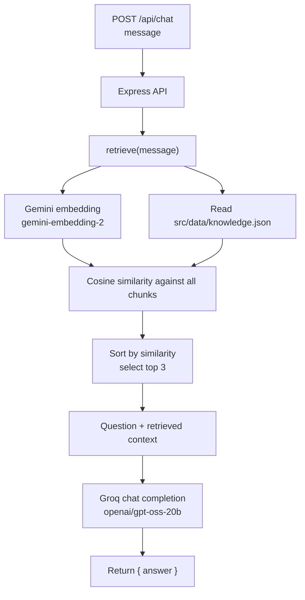

# RentSmart AI Chatbot Service

Express backend for the RentSmart Retrieval-Augmented Generation (RAG) chatbot. It embeds a visitor's question, retrieves the three most similar knowledge chunks from a local JSON index, and asks a Groq chat model to answer using that retrieved context.

For the full repository architecture, widget integration, diagrams, and implementation boundaries, see the [root README](../README.md).

## Request architecture



## Knowledge ingestion

The ingestion entry point is `index.js`. Run it from this directory:

```bash
node index.js
```

It reads `knowledge/rentsmart.txt`, splits the content on blank lines, creates an embedding for each non-empty paragraph using Google's `gemini-embedding-2` model, and writes records containing `text` and `embedding` to `src/data/knowledge.json`.

Re-run ingestion after changing the source knowledge file. The API does not automatically regenerate a missing or stale JSON index at startup.

## API

The service listens on `PORT`, defaulting to `5005`.

| Method | Endpoint | Description |
|---|---|---|
| GET | `/health` | Basic health response |
| POST | `/api/chat` | Retrieve relevant context and generate an answer |

### Chat request

```http
POST /api/chat
Content-Type: application/json
```

```json
{
  "message": "How can I unlock a property's contact details?"
}
```

Success response:

```json
{
  "answer": "..."
}
```

An absent or whitespace-only message returns `400`. Unexpected errors are logged and return `500`.

## Retrieval and generation

- The query embedding is generated using `gemini-embedding-2`.
- The retriever reads the local JSON index and computes cosine similarity against every stored vector.
- It sorts matches in descending similarity order and returns the top 3 chunks by default.
- Retrieved chunk text and the original question are passed to Groq.
- The generation prompt instructs the model to use only the supplied RentSmart context and to acknowledge when the answer is not present.

This implementation uses a linear scan over a local JSON file. It does not use a vector database, similarity threshold, reranker, metadata filtering, or conversation memory.

## Configuration

Create `.env` in `chatbot-service/`:

```env
GEMINI_API_KEY=your_gemini_api_key
GROQ_API_KEY=your_groq_api_key
PORT=5005
```

The embedding model (`gemini-embedding-2`) and generation model (`openai/gpt-oss-20b`) are currently defined in source code rather than configured through environment variables.

## Install and run

```bash
npm install
node index.js       # Generate / refresh the knowledge index
node src/app.js     # Start the API
```

Run both commands from the `chatbot-service` directory. The current `package.json` does not define start or dev scripts.

## Dependencies

- Express — HTTP API
- `@google/genai` — Gemini text embeddings
- `groq-sdk` — answer generation
- `dotenv` — environment variables
- `cors` — cross-origin middleware

The service API is consumed by the separately maintained `chatbot-widget` in this repository.
